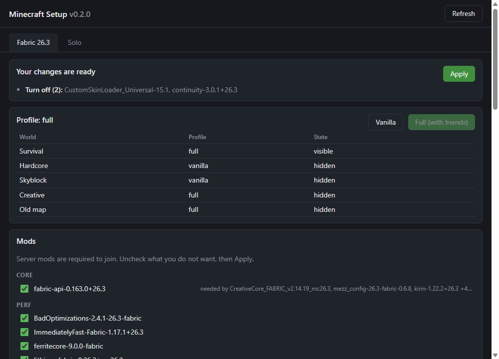
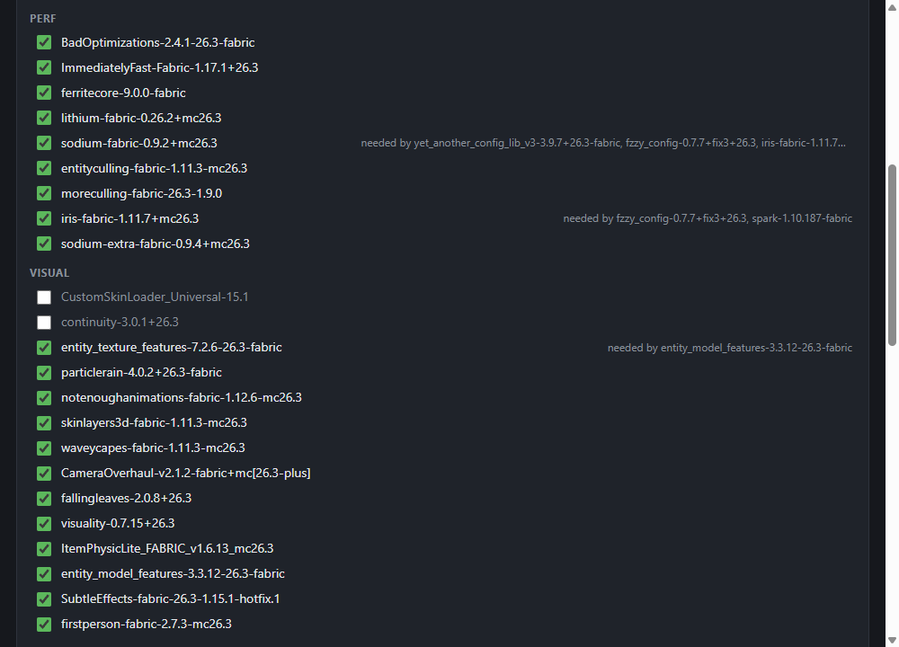
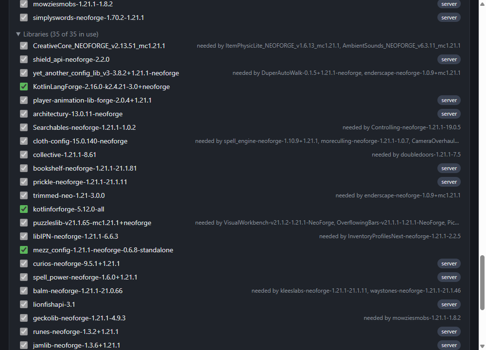

<div align="center">

# Minecraft Setup

**One exe that installs, updates and tunes our Minecraft modpacks.**

[](https://github.com/vkarach/minecraft-setup/releases/latest)

-5cb85c)



</div>

## Why

No more zips in the chat. Grab the exe once - from then on the app pulls the current mod list from this repo, shows
what changed and applies it with one button. Mods come straight from Modrinth and are checked by sha512 before they
touch your game.

## What it does

| | |
|---|---|
| **Finds your game** | Detects `.minecraft` and the TLauncher versions in it, and matches each pack to the right one. Tells you what to install when a version is missing. |
| **Your mods, your choice** | Server mods are locked on - everyone needs them to join. Client mods (shaders, HUD, sounds...) are checkboxes. |
| **Libraries sort themselves out** | A library stays on while anything ticked needs it, and goes away with the last mod that used it. |
| **Updates on start** | New, updated and removed mods are listed before anything happens. Replaced files go to `backup\`. |
| **Leaves your stuff alone** | Configs, `options.txt` and shader settings are written only when missing. Mods you added yourself are never touched. |
| **Safe while playing** | Refuses to change a pack whose game is running. |
| **Profiles for 26.3** | Vanilla / Full switch with the world guard: worlds of the other profile are hidden so they never load with the wrong mods. |
| **Updates itself** | New app versions come from GitHub Releases, verified by sha256. |

<p align="center">
  
  
</p>

## Get started (friends)

1. Download **[minecraft-setup.exe](https://github.com/vkarach/minecraft-setup/releases/latest/download/minecraft-setup.exe)** and put it anywhere.
2. Run it. If Windows SmartScreen warns about an unknown app: **More info -> Run anyway** (the exe is not code-signed).
3. A pack says **Not installed**? Install the version it names in TLauncher, then press **Refresh**.
4. Untick what you do not want and press **Apply**. Close Minecraft first.

Next time just start the app again: if the pack changed, it shows what is new - press **Apply**.
The exe never has to be sent around again.

## FAQ

**Will it reset my settings?** No. Config files are only written where they do not exist yet, so your keybinds,
video settings and shader options stay.

**I added a mod myself.** It is listed under "Your own mods" and left alone.

**Something went wrong mid-update.** Every replaced or removed file is in `backup\update-<date>` inside the game folder.

**Where does it keep its data?** Your choices live in `minecraft-setup.json` in the game folder, a copy of the pack
list in `%LOCALAPPDATA%\minecraft-setup` (so it also opens offline).

## For the owner

Publishing appears only when the app finds a clone of this repo and git.

- Change mods in the live game folder. Every jar and pack archive must be a Modrinth file.
- **Publish** (button, or `uv run minecraft-setup publish <pack>`) writes `packs/<pack>/manifest.json` and the
  configs, then commits and pushes `packs/`. A new pack also needs `--title`, `--install` and, for 26.3-style packs,
  `--profiles`. Files that look like they hold a token or password are refused.
- Modrinth got a side wrong? Put `{"<jar name or project id>": "required" | "client"}` in `packs/<pack>/overrides.json`.
- New app version: bump `__version__` and `pyproject.toml`, push a tag `v<version>`. GitHub Actions tests, builds the
  exe and publishes it with its sha256.

## Development

```
uv sync
uv run pytest                      # offline tests; -m network for the live Modrinth ones
uv run minecraft-setup-gui         # the app
uv run minecraft-setup --help      # the same engine from the command line
uv run pyinstaller minecraft-setup.spec
```

Python 3.14, pywebview for the window, plain HTML/CSS/JS for the screen, PyInstaller for the one-file exe.
